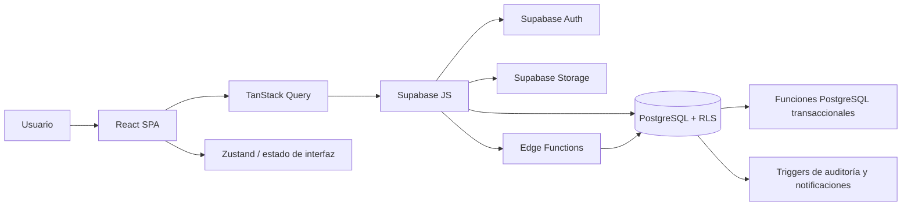
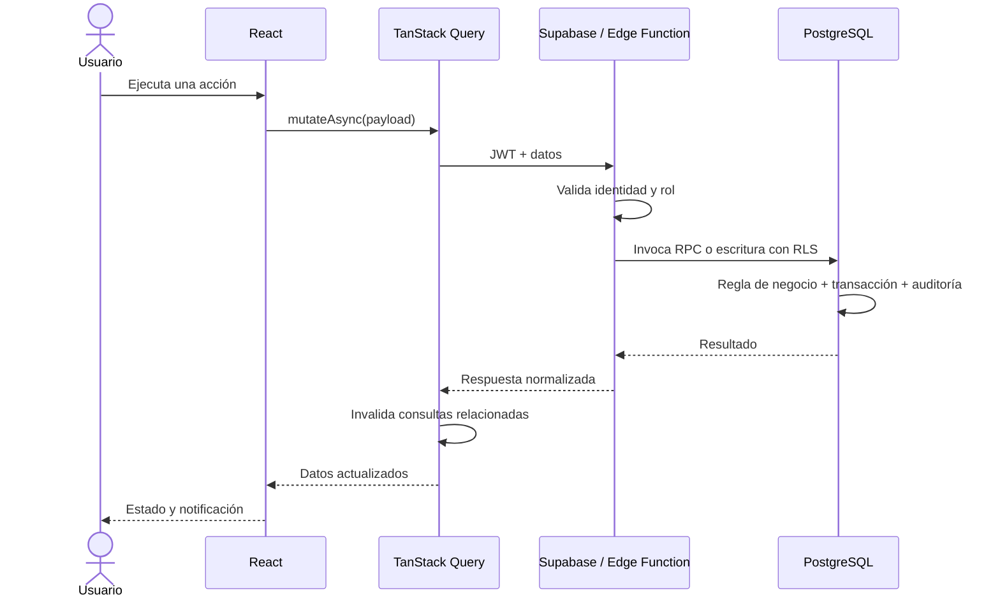

# Arquitectura actual del Sistema de Solicitudes de Servicio

## 1. Propósito y alcance

El Sistema de Solicitudes de Servicio es una aplicación web responsiva para administrar el ciclo
completo de servicios de campo: creación de solicitudes, priorización, asignación, planificación de
rutas y vehículos, ejecución en sitio, registro de avances y materiales, comunicación con el
cliente, validación y cierre.

El sistema soporta los roles `administrador`, `encargado`, `operador`, `cliente` y `solicitante`.
Una cuenta puede tener varios roles y cambiar el rol activo durante la sesión.

Este documento describe la arquitectura implementada actualmente. La especificación funcional de
referencia se encuentra en `docs/requerimientos-sistema-solicitudes-servicio.md`.

## 2. Vista general



La solución es una SPA construida con React y TypeScript. Supabase funciona como backend integral:
autenticación, base de datos PostgreSQL, autorización mediante RLS, almacenamiento de archivos y
Edge Functions. No existe un servidor de aplicación tradicional separado.

## 3. Tecnologías principales

| Área | Tecnología | Responsabilidad |
| --- | --- | --- |
| Interfaz | React 18 + TypeScript | Composición de pantallas y comportamiento del cliente |
| Build | Vite 6 | Desarrollo local y empaquetado de producción |
| Estilos | Tailwind CSS | Diseño responsivo y tokens semánticos |
| Componentes | Primitivas locales + Radix UI | Controles accesibles, diálogos y menús |
| Estado remoto | TanStack Query | Consultas, caché, mutaciones e invalidación |
| Estado local | Zustand | Preferencias y estado transversal de interfaz |
| Formularios | React Hook Form + Zod / estado React | Captura y validación de datos |
| Mapas | Leaflet + React Leaflet | Ubicaciones y visualización geográfica |
| Gráficas | Recharts | Paneles e informes |
| Backend | Supabase | Auth, PostgreSQL, RLS, Storage y Edge Functions |
| Notificaciones UI | Sonner | Confirmaciones y errores de operaciones |

## 4. Organización del frontend

La estructura combina organización por dominio con Atomic Design:

```text
src/
├── app/                  # App, proveedores globales y QueryClient
├── components/
│   ├── atoms/            # Primitivas visuales locales
│   ├── molecules/        # Composiciones pequeñas reutilizables
│   ├── organisms/        # Formularios y administradores funcionales
│   ├── templates/        # AppShell y shells administrativos
│   └── pages/            # Pantallas por rol y área
├── features/             # Acceso a datos, tipos, esquemas y lógica por dominio
├── hooks/                # Hooks transversales
├── lib/                  # Supabase, i18n y utilidades
├── stores/               # Estado global de interfaz con Zustand
└── styles/               # Variables CSS y estilos globales
```

### 4.1 Arranque y proveedores

`src/main.tsx` monta la aplicación en modo estricto y registra `AppProviders`. El proveedor global
crea un `QueryClient` con `staleTime` de 30 segundos y un reintento para consultas. Las mutaciones
no tienen reintentos automáticos.

### 4.2 Navegación

Actualmente no existe un router de cliente. `HomePage` selecciona la experiencia según:

1. La sesión de Supabase.
2. Los roles obtenidos desde el perfil del usuario.
3. El rol activo seleccionado en `SessionToolbar`.

Las áreas principales se cambian mediante estado local dentro de los dashboards. La única ruta URL
especial es `/bolsa-empleo`, detectada directamente desde `window.location.pathname`. Por esta
razón, las vistas internas no son enlazables individualmente mediante URL.

### 4.3 Estado

- **Estado del servidor:** TanStack Query administra consultas, caché, estados de carga, errores e
  invalidación después de mutaciones.
- **Estado de interfaz:** Zustand conserva idioma y estado colapsado del menú en `localStorage`, bajo
  la clave `control-solicitudes-ui`.
- **Estado de pantalla:** formularios abiertos, solicitudes seleccionadas, filtros y paginación se
  mantienen normalmente con `useState` en la página correspondiente.
- **Borradores del operador:** el módulo de avance puede conservar información temporal para evitar
  pérdida accidental durante el trabajo en campo.

### 4.4 Sistema visual

Las primitivas viven en `src/components/atoms`; no se consume un paquete externo de shadcn/ui. Los
componentes de mayor nivel deben reutilizar estas primitivas y los tokens semánticos definidos en
`src/styles/globals.css` y `tailwind.config.ts`.

Se distinguen dos contextos mediante `WorkspacePanel`:

- `management`: edición o gestión activa, con acento primario.
- `list`: búsqueda, filtros, tablas o grids, con fondo neutro.

Las áreas complementarias que no deben permanecer abiertas usan `DisclosurePanel`, por ejemplo
materiales, técnicos, comunicaciones y tracking de una solicitud.

## 5. Módulos funcionales

### 5.1 Autenticación y perfiles

Supabase Auth gestiona credenciales y sesiones. La tabla pública `usuarios` amplía la identidad con
nombre, teléfono, asociación a cliente y estado. `usuario_roles` permite varios roles por cuenta.
El primer administrador debe asignarse mediante SQL, pues ningún usuario puede autoasignarse roles.

### 5.2 Solicitudes

Es el agregado central del sistema. Incluye datos generales, cliente, ubicación, tipo, prioridad,
estado, solicitante, operador, SLA y fechas del ciclo de vida.

Los hooks del dominio se encuentran en `src/features/solicitudes`. Las operaciones sensibles —como
asignar, rechazar, cambiar estado, resolver peticiones y reabrir— pasan por la Edge Function
`gestionar-solicitud` y por funciones transaccionales de PostgreSQL.

### 5.3 Operación en campo

El operador consulta sus solicitudes asignadas y registra avances, tiempos, materiales, técnicos y
adjuntos. `registrar-avance` valida el rol y delega la operación atómica en PostgreSQL. El frontend
incluye estados de conectividad y manejo de borradores.

### 5.4 Rutas y flota

El modelo vigente utiliza rutas de proceso agrupadas:

- `rutas_proceso`
- `ruta_solicitudes`
- `ruta_vehiculos`
- `ruta_movimientos_vehiculo`

Una ruta puede agrupar varias solicitudes y vehículos, además de un responsable. Los movimientos
registran combustible, kilometraje, gastos y otros datos de control de flota. La tabla histórica
`rutas`, asociada uno a uno con una solicitud, permanece por compatibilidad, pero su formulario no
está conectado a las pantallas actuales.

### 5.5 Clientes y documentos

Los clientes tienen ubicaciones, usuarios asociados, solicitudes y documentos como contratos. Los
archivos se almacenan en Supabase Storage y sus metadatos en PostgreSQL. Las políticas RLS controlan
la carga y consulta según el cliente y el rol del usuario.

### 5.6 Comunicaciones

Cada solicitud puede contener mensajes, adjuntos y proformas. La comunicación queda relacionada con
la solicitud, el remitente y el cliente, y forma parte de la consulta administrativa del caso.

### 5.7 Notificaciones

Existen notificaciones internas para administradores y encargados ante eventos relevantes, como
cambios de clientes, documentos y postulaciones de empleo. El estado de lectura es individual por
usuario y alimenta los contadores de elementos no vistos en la navegación.

### 5.8 Reportes

El sistema ofrece métricas operativas, costos de materiales y flota. Las agregaciones relevantes se
calculan en PostgreSQL y se presentan mediante tablas y gráficas en React.

## 6. Backend Supabase

```text
supabase/
├── migrations/          # Esquema, RLS, RPC, triggers, buckets y datos controlados
└── functions/
    ├── _shared/         # CORS y utilidades de notificación/correo
    ├── admin-users/     # Administración privilegiada de cuentas
    ├── gestionar-solicitud/
    └── registrar-avance/
```

### 6.1 Base de datos y migraciones

Las migraciones SQL son la fuente de verdad del esquema y se aplican en orden por su nombre de
fecha. Incluyen tablas, restricciones, índices, RLS, funciones, triggers, Storage y datos semilla.
Los datos demostrativos utilizan UUID fijos y operaciones idempotentes cuando corresponde.

### 6.2 Edge Functions

- **`admin-users`:** única función que usa la clave `service_role`; crea, actualiza y elimina
  cuentas, roles y contraseñas bajo validación administrativa.
- **`gestionar-solicitud`:** valida al encargado o administrador y coordina transiciones y SLA.
- **`registrar-avance`:** valida al operador y registra el avance de manera transaccional.

Salvo las operaciones que requieren privilegios administrativos, las funciones trabajan con el JWT
del usuario para conservar el efecto de RLS y registrar al actor real.

### 6.3 Lógica transaccional

Las reglas con varias escrituras se implementan principalmente como funciones PostgreSQL
`security definer`, con `search_path` explícito. Las Edge Functions validan y orquestan; PostgreSQL
garantiza atomicidad, restricciones de negocio y auditoría.

### 6.4 Almacenamiento

Supabase Storage conserva evidencias de solicitudes, adjuntos de comunicaciones, fotografías de
vehículos y documentos de clientes. La base de datos mantiene nombres, rutas, MIME, tamaños y
relaciones con las entidades. El acceso se limita mediante políticas asociadas al usuario y su rol.

## 7. Seguridad y autorización

La autorización se aplica principalmente en el backend:

1. Supabase Auth emite el JWT de sesión.
2. Las relaciones `usuarios` y `usuario_roles` determinan el alcance funcional.
3. Las políticas RLS restringen lectura y escritura por rol, usuario y cliente.
4. Las Edge Functions validan acciones sensibles antes de invocar RPC.
5. Las funciones transaccionales validan reglas y escriben la auditoría.

Ocultar una opción en React mejora la experiencia, pero no constituye una barrera de seguridad. La
base de datos y las funciones son la autoridad final.

## 8. Trazabilidad y auditoría

La arquitectura registra eventos de negocio, no únicamente cambios técnicos. Existen líneas de
tiempo para solicitudes y rutas con actor, fecha, tipo, descripción y datos adicionales.

En solicitudes se registran, entre otros:

- cambios de estado y prioridad;
- asignaciones y reasignaciones;
- avances y materiales;
- adjuntos y técnicos;
- validaciones y peticiones de cierre o cancelación;
- incorporación a rutas y movimientos relacionados;
- comunicaciones y operaciones automáticas.

Las automatizaciones deben indicar qué se ejecutó, cuándo, por qué y con qué resultado. La captura
se realiza mediante triggers y funciones PostgreSQL para que también cubra operaciones originadas
fuera de la interfaz.

## 9. Flujo típico de una operación



## 10. Internacionalización

`src/lib/i18n.ts` contiene los mensajes en español e inglés. El tipo `ClaveTraduccion` se deriva del
bloque español, lo que obliga a mantener las claves en ambos idiomas. La adopción es incremental y
todavía existen textos en español escritos directamente en algunos componentes.

## 11. Calidad, construcción y despliegue

Comandos principales:

```bash
npm run dev
npm run lint
npm run format:check
npm run build
```

`npm run build` ejecuta `tsc -b` antes de Vite, por lo que también valida TypeScript estricto. CI
ejecuta lint, comprobación de formato y build en cambios hacia `main`.

Playwright está instalado como dependencia de desarrollo, pero actualmente no hay configuración ni
suite automatizada. La validación se basa en build, lint y pruebas manuales en el servidor local.

Los cambios de backend se despliegan con:

```bash
supabase db push
supabase functions deploy <nombre>
supabase secrets set --env-file supabase/.env.local
```

## 12. Restricciones y deuda técnica conocida

- La ausencia de router impide enlaces profundos y navegación basada en URL dentro de la SPA.
- Conviven formularios con React Hook Form/Zod y formularios controlados manualmente.
- La internacionalización todavía no cubre todos los textos.
- No existe una suite automatizada de pruebas.
- El modelo antiguo de rutas permanece en esquema y código muerto, aunque el modelo vigente es el de
  rutas de proceso agrupadas.
- El bundle principal supera el umbral recomendado de Vite y puede beneficiarse de división de
  código mediante importaciones dinámicas.

## 13. Criterios para extender la arquitectura

Al incorporar una funcionalidad nueva:

1. Colocar tipos y acceso a datos en `src/features/<dominio>`.
2. Mantener las consultas y mutaciones fuera de los componentes cuando sea práctico.
3. Reutilizar primitivas locales, `WorkspacePanel` y `DisclosurePanel`.
4. Agregar textos nuevos al sistema i18n.
5. Aplicar autorización real mediante RLS, RPC o Edge Functions.
6. Registrar trazabilidad para toda operación o automatización relevante.
7. Usar migraciones secuenciales como fuente de verdad del backend.
8. Validar con formato, lint, build y pruebas manuales proporcionales al cambio.
