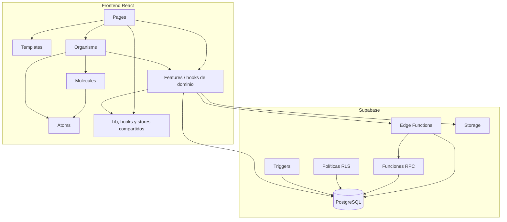
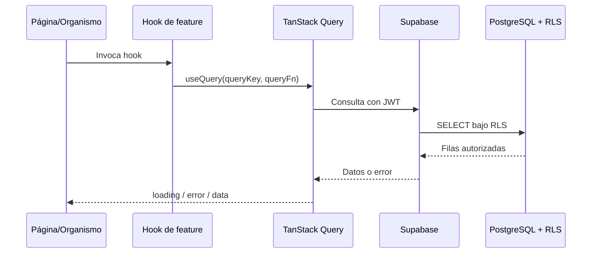
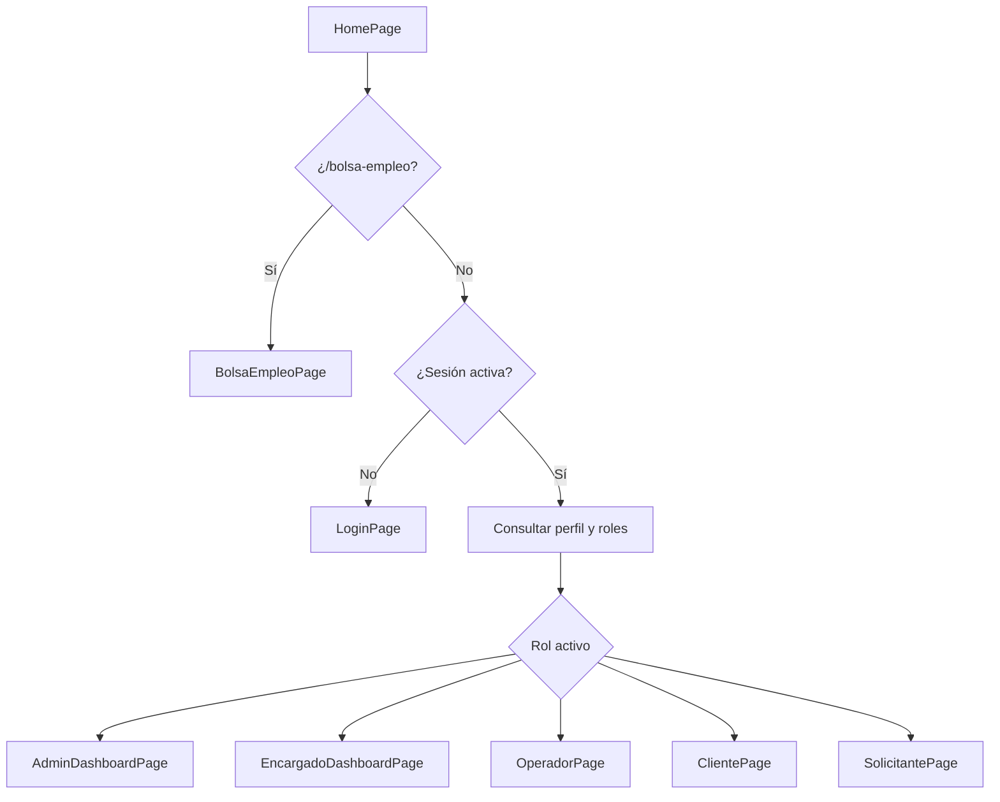
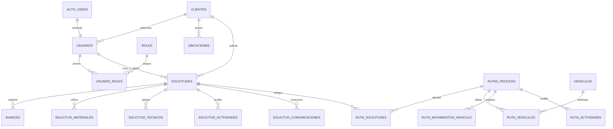
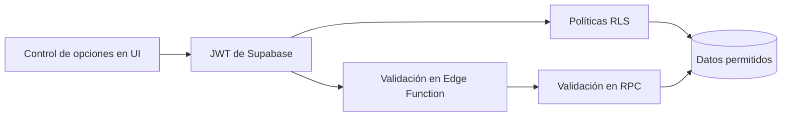
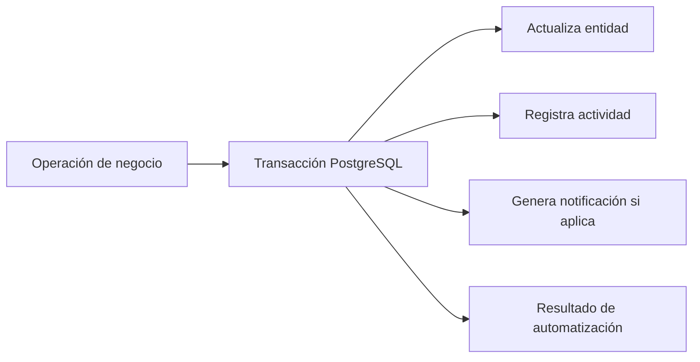
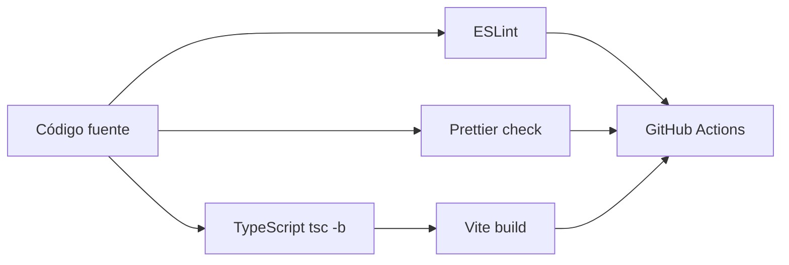

# Arquitectura técnica estructural del software

## 1. Objetivo

Este documento describe cómo está organizado técnicamente el Sistema de Solicitudes de Servicio,
qué responsabilidad tiene cada capa y cómo deben relacionarse sus elementos. Su propósito es servir
como guía para mantenimiento, revisión técnica e incorporación de nuevas funcionalidades.

La arquitectura funcional general se documenta en `docs/arquitectura-actual.md`.

## 2. Estilo arquitectónico

El sistema adopta una arquitectura de aplicación web de tres niveles lógicos:

1. **Presentación:** SPA desarrollada con React y TypeScript.
2. **Aplicación e integración:** hooks de dominio, TanStack Query y Edge Functions.
3. **Datos y reglas:** PostgreSQL, funciones RPC, triggers, RLS y Supabase Storage.

En el frontend se combinan dos criterios estructurales:

- **Feature-first:** tipos, consultas y mutaciones se agrupan por dominio.
- **Atomic Design:** los elementos visuales se organizan por nivel de composición.



## 3. Estructura física del repositorio

```text
/
├── .github/workflows/       # Integración continua
├── docs/                    # Requerimientos y documentación técnica
├── public/                  # Recursos públicos servidos por Vite
├── src/                     # Aplicación frontend
│   ├── app/                 # Composición raíz y proveedores
│   ├── components/          # Sistema de componentes
│   │   ├── atoms/
│   │   ├── molecules/
│   │   ├── organisms/
│   │   ├── templates/
│   │   └── pages/
│   ├── features/            # Dominios y acceso a datos
│   ├── hooks/               # Comportamiento transversal
│   ├── lib/                 # Clientes y utilidades compartidas
│   ├── stores/              # Estado global de interfaz
│   ├── styles/              # CSS global y tokens
│   └── main.tsx             # Punto de entrada
├── supabase/
│   ├── functions/           # Edge Functions
│   └── migrations/          # Evolución completa del backend
├── components.json          # Alias y configuración de primitivas
├── tailwind.config.ts       # Exposición de tokens a Tailwind
├── tsconfig.app.json        # TypeScript estricto del frontend
└── vite.config.ts           # Build y alias de Vite
```

El alias `@/*` apunta a `src/*` y debe utilizarse para importaciones internas que atraviesen
directorios.

## 4. Capas del frontend

### 4.1 Capa de arranque

| Archivo | Responsabilidad |
| --- | --- |
| `src/main.tsx` | Monta React, estilos globales y proveedores |
| `src/app/app.tsx` | Componente raíz de la aplicación |
| `src/app/providers.tsx` | Configura TanStack Query y proveedores globales |

El `QueryClient` define para las consultas un tiempo de frescura de 30 segundos y un reintento. Las
mutaciones no se reintentan automáticamente para evitar repetir operaciones de negocio.

### 4.2 Capa de páginas

`src/components/pages` contiene las unidades navegables de la SPA. Una página:

- coordina el estado de pantalla;
- selecciona hooks de dominio;
- gestiona filtros, selección y paginación;
- compone organismos y plantillas;
- no debería contener acceso directo complejo a Supabase.

Las páginas se subdividen por rol cuando el alcance lo requiere:

```text
pages/
├── admin/
├── encargado/
├── operador/
├── cliente/
└── solicitante/
```

`HomePage` actúa como selector de experiencia. Evalúa la sesión, consulta el perfil y renderiza la
página raíz correspondiente al rol activo.

### 4.3 Capa de plantillas

Las plantillas definen estructura de página, navegación y regiones de contenido. No implementan
reglas de negocio. Ejemplos:

- `AppShell`: envolvente general de la aplicación.
- `AdminShell`: navegación y disposición de áreas administrativas.

### 4.4 Capa de organismos

Los organismos encapsulan unidades funcionales completas, como formularios, administradores de
catálogos, tracking, materiales, técnicos y comunicaciones.

Un organismo puede:

- consumir hooks de `features`;
- mantener estado local del formulario;
- mostrar carga, error, vacío y confirmación;
- componer moléculas y átomos.

Debe evitar asumir qué página lo contiene para poder reutilizarse en otros roles.

### 4.5 Moléculas

Las moléculas son patrones reutilizables formados por varios átomos. Entre los patrones actuales se
encuentran:

- encabezados de página;
- paginación;
- campos de formulario;
- indicadores SLA;
- paneles de lista o gestión mediante `WorkspacePanel`;
- secciones plegables mediante `DisclosurePanel`.

### 4.6 Átomos

`src/components/atoms` es la biblioteca visual local. Contiene botones, entradas, selectores,
diálogos, badges, tabs, tooltips y otros controles básicos.

Los átomos se construyen sobre HTML, Tailwind y primitivas Radix UI. Esta carpeta es la API del
sistema de diseño; una funcionalidad nueva debe extenderla cuando necesite una primitiva general,
en lugar de introducir controles incompatibles dentro de una página.

## 5. Estructura por dominio

Cada dominio del frontend se ubica en `src/features/<dominio>`:

```text
features/<dominio>/
├── hooks/       # Consultas y mutaciones
├── types/       # Contratos TypeScript
├── schemas/     # Validación Zod, cuando aplica
└── lib/         # Utilidades exclusivas del dominio
```

Dominios implementados actualmente:

| Dominio | Responsabilidad principal |
| --- | --- |
| `auth` | Sesión, perfil y roles |
| `catalogos` | Datos parametrizables |
| `cliente` | Portal, documentos y tracking del cliente |
| `configuracion` | Marca e identidad del sistema |
| `flota` | Vehículos, rutas de proceso y tracking de rutas |
| `notificaciones` | Notificaciones operativas e internas |
| `operador` | Trabajo de campo, borradores y adjuntos |
| `reportes` | Consultas agregadas y paneles |
| `rutas` | Compatibilidad con el control de rutas anterior |
| `solicitudes` | Creación, gestión, materiales, comunicaciones y tracking |
| `tecnicos` | Técnicos asociados a solicitudes |
| `usuarios` | Administración de cuentas y roles |

## 6. Reglas de dependencia

La dirección esperada de las dependencias es:

```text
pages ───────► templates / organisms / molecules / atoms
organisms ───► molecules / atoms / features
molecules ───► atoms / lib
features ────► lib
atoms ───────► lib
```

Reglas estructurales:

1. `features` no debe importar páginas ni componentes visuales.
2. Los átomos no deben depender de organismos, páginas o dominios.
3. Las páginas coordinan, pero la obtención de datos debe residir preferiblemente en hooks.
4. La lógica transaccional crítica no debe implementarse únicamente en React.
5. Los tipos compartidos de un dominio deben vivir junto a sus hooks.
6. Las utilidades transversales pertenecen a `src/lib` o `src/hooks`.
7. No se deben crear dependencias circulares entre dominios.

## 7. Estado y flujo de datos

### 7.1 Clasificación del estado

| Tipo | Herramienta | Ejemplos |
| --- | --- | --- |
| Remoto | TanStack Query | solicitudes, usuarios, rutas, materiales |
| Sesión | Supabase Auth + hook | usuario autenticado y token |
| Global de UI | Zustand | idioma y menú colapsado |
| Local | `useState` | filtros, selección, paneles abiertos |
| Formulario | React Hook Form o `useState` | valores y validaciones |
| Temporal persistente | almacenamiento local | borradores de avances |

### 7.2 Flujo de consulta



### 7.3 Flujo de mutación

Las mutaciones se implementan dentro del hook del dominio. Según el riesgo, llaman directamente a
una tabla, invocan una función RPC o utilizan una Edge Function. Después del éxito invalidan las
claves de consulta afectadas para recuperar el estado confirmado por el servidor.

No se confía en una actualización optimista para transiciones sensibles de negocio.

## 8. Navegación y composición por rol

No existe un router interno. La composición principal sigue este flujo:



`SessionToolbar` permite cambiar el rol activo sin cerrar la sesión. El rol seleccionado es estado
de React y no forma parte de la URL.

## 9. Frontera con Supabase

### 9.1 Cliente de integración

`src/lib/supabase.ts` inicializa una única instancia de `supabase-js`. Los hooks usan esta instancia
para:

- consultas y mutaciones sobre tablas;
- invocación de funciones RPC;
- ejecución de Edge Functions;
- operaciones sobre Storage;
- observación y cierre de sesión.

Las credenciales del navegador corresponden a la clave pública. La autorización efectiva depende
del JWT y de las políticas RLS.

### 9.2 Selección de mecanismo de escritura

| Tipo de operación | Mecanismo preferido |
| --- | --- |
| CRUD simple autorizado por RLS | Acceso directo con `supabase-js` |
| Varias escrituras atómicas | Función PostgreSQL RPC |
| Validación adicional y orquestación | Edge Function + RPC |
| Administración de Auth | Edge Function con `service_role` |
| Archivo binario | Storage + registro de metadatos |

## 10. Estructura del backend

### 10.1 Migraciones

`supabase/migrations` es la fuente de verdad del backend. Cada cambio debe añadirse en una migración
secuencial y no mediante modificaciones manuales no documentadas.

Las migraciones contienen:

- tablas y relaciones;
- restricciones e índices;
- funciones transaccionales;
- triggers de auditoría y automatización;
- políticas RLS;
- configuración de buckets y políticas de Storage;
- datos iniciales controlados.

### 10.2 Modelo lógico principal



El diagrama representa relaciones estructurales relevantes y no sustituye el esquema SQL de las
migraciones.

### 10.3 Edge Functions

```text
supabase/functions/
├── _shared/
│   ├── cors.ts
│   └── notificaciones.ts
├── admin-users/index.ts
├── gestionar-solicitud/index.ts
└── registrar-avance/index.ts
```

Responsabilidades:

- validar el JWT y los roles requeridos;
- validar la forma básica de la solicitud;
- coordinar servicios de Supabase;
- invocar la operación transaccional correspondiente;
- devolver errores HTTP coherentes.

La lógica de integridad que debe cumplirse independientemente del cliente permanece en PostgreSQL.

## 11. Seguridad estructural

La seguridad utiliza defensa en profundidad:



- La interfaz solo orienta; no es una frontera de seguridad.
- RLS restringe filas y operaciones según usuario, rol y cliente.
- Las funciones RPC verifican precondiciones y transiciones.
- `security definer` se usa únicamente cuando la operación lo requiere y con `search_path`
  controlado.
- `admin-users` es el único componente autorizado para usar `service_role`.
- Los archivos se protegen mediante políticas de Storage equivalentes al modelo de datos.

## 12. Auditoría y eventos internos

La auditoría está acoplada a la transacción de negocio mediante funciones y triggers. Esto evita que
la trazabilidad dependa de que una página recuerde registrar el evento.



Las líneas de tiempo de solicitudes y rutas leen los registros de actividad. La interfaz puede
filtrar, ordenar y paginar esos eventos, pero la generación pertenece al backend.

## 13. Archivos y adjuntos

Los binarios no se almacenan dentro de PostgreSQL. El patrón estructural es:

1. Validar tipo y tamaño en el cliente.
2. Subir el archivo a un bucket de Supabase Storage.
3. Registrar en PostgreSQL la ruta, nombre, MIME, tamaño, entidad y actor.
4. Consultar o descargar mediante una URL autorizada.
5. Aplicar las mismas restricciones de negocio tanto al bucket como a la tabla de metadatos.

Este patrón se utiliza para evidencias, documentos de clientes, comunicaciones y fotografías de
vehículos.

## 14. Manejo de errores y estados de interfaz

Toda unidad que consume datos remotos debe contemplar:

- carga mediante `Skeleton` o indicador equivalente;
- estado vacío con explicación y próxima acción cuando corresponda;
- error visible con `role="alert"`;
- confirmación mediante `toast` después de una mutación exitosa;
- bloqueo del botón mientras una operación está pendiente;
- invalidación de datos después de guardar.

Las mutaciones no deben ocultar errores ni asumir que el cambio fue aceptado hasta recibir la
confirmación del backend.

## 15. Convenciones técnicas

### TypeScript

- El modo estricto está activo.
- `noUnusedLocals` y `noUnusedParameters` convierten valores sin uso en errores de build.
- Los contratos del backend deben reflejarse en tipos del dominio.
- Se evita `any`; cuando una frontera dinámica lo exige, debe reducirse a un alcance mínimo.

### Componentes

- Objetivos táctiles principales de al menos 44 px.
- Uso de tokens semánticos en lugar de colores literales.
- Uso de `Dialog`, `AlertDialog` o `Sheet` para capas superpuestas.
- Listas y administración deben diferenciarse mediante el patrón visual común.
- Información secundaria extensa debe permanecer plegada cuando no sea indispensable.

### Hooks

- No se suprimen reglas de hooks con comentarios de ESLint.
- Las claves de React Query deben ser estables y específicas del dominio.
- Una mutación debe invalidar todas las consultas cuyo resultado pueda haber cambiado.

### Formato

Prettier utiliza comillas simples, sin punto y coma, comas finales y un ancho máximo de 100
caracteres.

## 16. Construcción y validación



Comandos:

```bash
npm run dev
npm run lint
npm run format:check
npm run build
```

No existe todavía una suite automatizada. Playwright está instalado, pero no tiene configuración ni
especificaciones. Los cambios deben comprobarse mediante build y pruebas manuales proporcionales al
riesgo.

## 17. Puntos de extensión

### Agregar una nueva pantalla

1. Crear la página en `components/pages/<rol-o-area>`.
2. Crear hooks y tipos en el dominio correspondiente.
3. Componer organismos y primitivas existentes.
4. Registrar la selección dentro del dashboard aplicable.
5. Verificar permisos en RLS; no depender solo del menú.

### Agregar una nueva entidad

1. Crear una migración con tabla, relaciones, restricciones e índices.
2. Definir RLS y políticas de Storage si existen archivos.
3. Agregar auditoría y notificaciones cuando sea un evento relevante.
4. Crear tipos y hooks en `features`.
5. Crear el organismo administrador o extender `CatalogManager`.

### Agregar una operación transaccional

1. Definir precondiciones y resultado esperado.
2. Implementar una función PostgreSQL atómica.
3. Protegerla con roles y permisos explícitos.
4. Usar una Edge Function si requiere orquestación o integración privilegiada.
5. Registrar actor, fecha, motivo y resultado.
6. Invalidar las consultas relacionadas en el frontend.

## 18. Límites estructurales actuales

- La navegación basada en estado dificulta enlaces profundos y separación de bundles por ruta.
- Algunos organismos concentran formulario, acciones y visualización; conviene extraer unidades
  cuando crezcan más.
- Conviven dos estrategias de formularios: React Hook Form/Zod y estado controlado manualmente.
- La cobertura de internacionalización es parcial.
- El modelo antiguo de ruta permanece como compatibilidad y debe evitarse en funcionalidades nuevas.
- El bundle principal puede beneficiarse de carga diferida por módulo.
- La ausencia de pruebas automáticas eleva el costo de cambios estructurales amplios.

## 19. Estructura objetivo para cambios futuros

La evolución debe conservar estas fronteras:

```text
Interfaz visual
    ↓
Página u organismo coordinador
    ↓
Hook del dominio
    ↓
Supabase JS / Edge Function
    ↓
RLS + función transaccional PostgreSQL
    ↓
Datos + auditoría + notificaciones
```

Una funcionalidad se considera estructuralmente completa cuando posee interfaz consistente,
contratos tipados, autorización en backend, transacción segura, trazabilidad y validación de sus
estados de carga, error y éxito.
