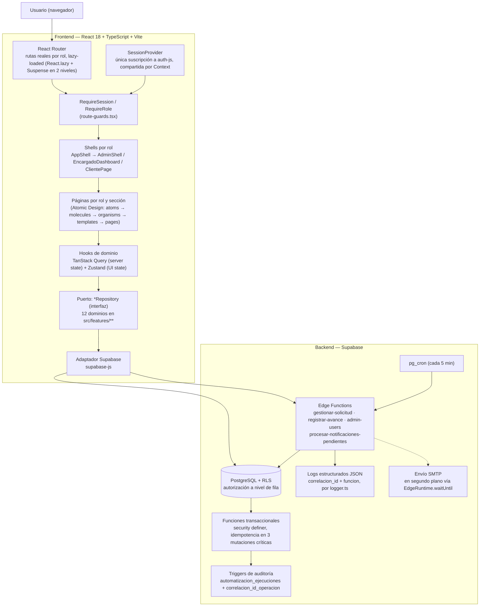
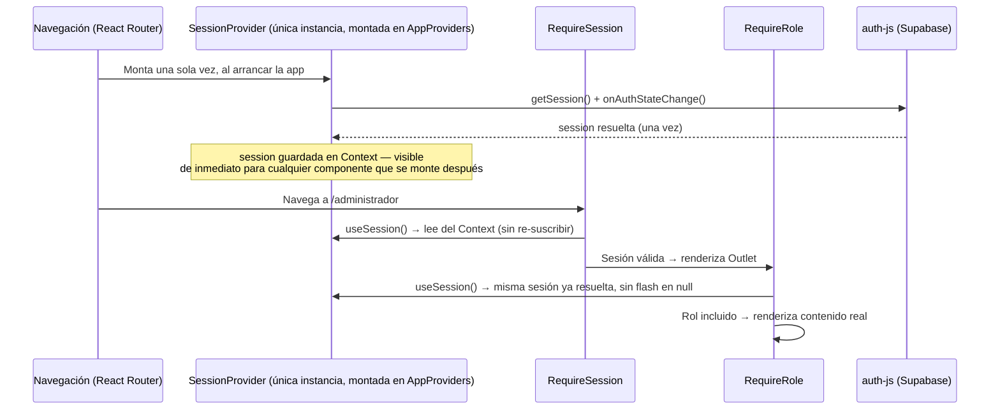

# Estado de la arquitectura según la propuesta escalable

**Fecha:** 22 de agosto de 2026 (actualizado el mismo día tras verificación en navegador real)
**Origen:** ejecución multi-agente de `Propuesta_Arquitectura_Escalable_React_Supabase.md` (propuesta
adjuntada por el usuario) sobre el Sistema de Solicitudes de Servicio, en una sesión única orquestada
con Claude Code.

Este documento es el punto de entrada a la iniciativa completa: resume qué cambió, muestra la
arquitectura resultante con su diagrama, justifica cada elemento importante, documenta una corrección
real encontrada al probar en navegador después del cierre de la iniciativa, y remite a los 5 informes
detallados (uno por fase) para el detalle línea-por-línea de cada cambio y su verificación.

---

## 1. Resumen ejecutivo

| Fase | Nombre (propuesta original) | Estado | Informe detallado |
|---|---|---|---|
| 0 | Medición y decisiones | ✅ Completa | `informe-arquitectura-fase-1.md` §6.1 |
| 1 | Fronteras y calidad | ✅ Completa | `informe-arquitectura-fase-1.md`, `-fase-2.md` §1-2 |
| 2 | Integración segura | ✅ Completa | `informe-arquitectura-fase-2.md` |
| 3 | Rendimiento y datos | ✅ Completa (2 de 5 sub-ítems ejecutables; 3 diferidos con evidencia) | `informe-arquitectura-fase-3.md` |
| 4 | Observabilidad y continuidad | ✅ Completa (logs + runbook; métricas/APM diferidos) | `informe-arquitectura-fase-4.md` |
| 5 | Escalamiento basado en evidencia | ⏸️ Documentada, sin cambios de código — explícitamente condicionada a evidencia de producción inexistente hoy | `informe-arquitectura-fase-5.md` |

**Lo que cambió, en una frase por fase**: pruebas automatizadas + patrón puertos/adaptadores en los
12 dominios de `src/features/**` + router real por URL (Fase 0-1) → normalización de errores +
notificaciones desacopladas del camino crítico + `correlacion_id` de extremo a extremo + outbox con
reintentos + idempotencia en las 3 mutaciones críticas (Fase 2) → code-splitting por ruta + caché
selectiva para catálogos (Fase 3) → logs estructurados en todos los Edge Functions + runbook de
restauración (Fase 4) → criterios de activación documentados para réplicas/particiones/almacén
analítico/extracción de servicios, sin implementarlos todavía (Fase 5).

**Lo que deliberadamente no se hizo, y por qué** (no son omisiones, son decisiones documentadas):

- Paginación por cursor en `listarAdmin()`, revisión de índices con planes reales, política de
  retención — Fase 3, requieren datos/tráfico de producción que no existen en este entorno.
- Un proveedor de observabilidad para métricas/alertas/APM — Fase 4, decisión de presupuesto y
  negocio.
- Réplicas, particionamiento, almacén analítico, extracción de servicios — Fase 5, la propia
  propuesta original los condiciona a evidencia que hoy no existe; implementarlos ahora sería
  sobre-ingeniería.
- Ejecutar el simulacro de restauración de respaldo — Fase 4, requiere crear un proyecto Supabase de
  prueba y presencia humana en la consola; solo se documentó el procedimiento
  (`runbook-restauracion-respaldo.md`).

### Verificación acumulada

Cada fase se verificó de forma independiente e íntegra (no solo por el reporte de cada agente) antes
de comitear: `npx tsc -b`, `npm run lint`, `npm run format:check`, `npm run build`, `npm run test`
(Vitest), `npm run test:e2e` (Playwright contra el build de producción). El detalle de cada corrida
está en la sección "Verificación" de cada informe de fase; todas terminaron limpias. Ningún cambio se
desplegó (`supabase db push` / `supabase functions deploy`) — eso permanece como paso manual del
usuario, por instrucción explícita.

---

## 2. Arquitectura resultante

### 2.1 Diagrama general

### 2.2 Diagrama de secuencia — resolución de sesión (el punto que se corrigió)

Antes del fix, cada flecha `useSession()` de este diagrama era una suscripción **nueva e independiente**
a `auth-js`, que arrancaba en `session: null` por un instante — ver sección 5.

Cambios centrales frente al estado previo a esta iniciativa:

1. **Navegación por URL real**, no por `useState` — cada vista de cada rol es enlazable, y desde la
   Fase 3 además carga en su propio chunk (`React.lazy`), bajando el bundle principal de 673 kB a
   260,58 kB.
2. **Cero llamadas a `supabase-js` directamente desde hooks** — los 12 dominios pasan por un
   puerto/adaptador, lo que los hace sustituibles en pruebas unitarias sin tocar componentes.
3. **El camino crítico de una mutación de negocio nunca espera una notificación por correo** — el
   registro de auditoría se escribe síncronamente, el envío SMTP se despacha después de responder.
4. **Toda invocación de Edge Function es correlacionable de extremo a extremo**: un mismo
   `correlacion_id` viaja en la respuesta HTTP al cliente, en `automatizacion_ejecuciones` (para las
   4 acciones de `gestionar-solicitud`), y ahora también en los logs estructurados de cualquier fallo
   — incluido el de un envío SMTP fallido en segundo plano o de una corrida del worker de outbox.
5. **Un reintento del cliente tras un timeout no duplica datos** — las 3 mutaciones que crean filas
   nuevas (`crear_solicitud_portal`, `crear_solicitud_gestor`, `registrar_avance_operador`) aceptan
   una clave de idempotencia opcional.

---

## 3. Justificación de cada elemento importante

Por qué existe cada pieza de la arquitectura — el problema concreto que resuelve, no solo qué hace.

| Elemento | Justificación (el problema que resuelve) | Archivos clave |
|---|---|---|
| **React Router + rutas por URL** | Antes, la vista activa vivía en un `useState` de `HomePage` — ninguna pantalla interna era enlazable ni recargable. Rompe deep-linking, botón atrás del navegador, y compartir un enlace a una sección específica. | `src/app/router.tsx`, `route-guards.tsx` |
| **Code-splitting por ruta (`React.lazy`)** | Sin esto, entrar como cualquier rol descargaba el código de los otros 4 roles — bundle principal de 673 kB. Cada rol/sección ahora es su propio chunk, descargado solo cuando se visita. | `router.tsx`, `cargando-ruta.tsx` |
| **`Suspense` en 2 niveles (raíz + anidado)** | Un solo `Suspense` en la raíz haría parpadear el shell/sidebar completo al cambiar de sub-sección dentro de un mismo rol. El nivel anidado limita el indicador de carga solo al área de contenido. | `admin-dashboard-page.tsx`, `encargado-dashboard-page.tsx`, `cliente-page.tsx` |
| **`SessionProvider` (Context, única suscripción)** | Cada uno de los 7 lugares que necesitan la sesión mantenía su propia suscripción independiente a `auth-js` — causaba un loop real de redirección al navegar entre rutas protegidas (sección 5). Un único Provider comparte el mismo estado ya resuelto. | `src/features/auth/hooks/use-session.tsx`, `src/app/providers.tsx` |
| **`StrictMode` desactivado** | Su doble-montaje de desarrollo duplica llamadas concurrentes a `getSession()`/`onAuthStateChange` sobre el cliente singleton de Supabase, entrando en una condición de carrera de `auth-js` que cuelga la pestaña. Sin impacto en producción — nunca duplica efectos fuera de desarrollo. | `src/main.tsx` |
| **Puertos/adaptadores (repository) en los 12 dominios** | Sin esta capa, los hooks llamaban a `supabase-js` directamente — imposible sustituir por un doble de prueba en tests unitarios sin tocar componentes, y cada dominio reinventaba su propio manejo de errores/config. | `src/features/*/{ports,adapters,lib}/*` |
| **TanStack Query (server state)** | Deduplica peticiones idénticas simultáneas (varios componentes pidiendo el mismo perfil no disparan 2 fetches), cachea con invalidación explícita en vez de refetch manual, y da estados de carga/error consistentes sin reinventar una máquina de estados por hook. | `AppProviders`, cada hook en `src/features/*/hooks/*` |
| **`staleTime` selectivo (catálogos = 5 min)** | El `staleTime` global de 30s es correcto para datos operativos volátiles (solicitudes), pero desperdicia peticiones en catálogos de baja volatilidad (clientes, tipos, materiales) — mutaciones propias igual invalidan al instante. | `use-catalogo.ts`, `use-marca.ts` |
| **Zustand (UI state)** | Estado de interfaz puro (idioma, menú colapsado) no necesita el peso de un Context re-renderizando todo el árbol, ni la semántica de "server state" de TanStack Query — Zustand da un store mínimo con persistencia selectiva a `localStorage`. | `src/stores/ui.store.ts` |
| **Normalización de errores (`normalizarError`)** | Sin esto, cada componente decidía por su cuenta cómo mostrar un error de Postgres/PostgREST/Edge Function — mensajes inconsistentes, algunos crudos (`error.message` de una excepción JS genérica) filtrándose a la UI. | `src/lib/errores.ts` |
| **Notificaciones desacopladas del camino crítico** | Antes, `gestionar-solicitud` esperaba (`await`) el envío SMTP completo antes de responder — un SMTP lento o caído retrasaba una operación de negocio ya exitosa. Ahora el registro de auditoría es síncrono (sin ventana de carrera) y el envío real corre después de responder. | `supabase/functions/_shared/notificaciones.ts` |
| **`correlacion_id` de extremo a extremo** | Sin un identificador común, un reporte de usuario ("me dio error") no se podía cruzar con el log del servidor ni con el registro de auditoría de esa operación puntual — soporte tenía que adivinar cuál fue la invocación. | Edge Functions (`respuesta()` closure), `automatizacion_ejecuciones.correlacion_id_operacion`, `logger.ts` |
| **Idempotencia en las 3 mutaciones que crean filas** | Un reintento del cliente tras un timeout de red (señal débil, típico del operador en campo) repetía la creación completa — solicitudes o avances duplicados. La clave de idempotencia hace que un reintento con la misma clave devuelva el resultado ya creado. | `crear_solicitud_portal`, `crear_solicitud_gestor`, `registrar_avance_operador`, `idempotencia_claves` |
| **Outbox con `pg_cron` (reintentos de notificación)** | Una notificación que falla en el envío en segundo plano (SMTP caído en ese instante) antes se perdía silenciosamente — no había ningún mecanismo de reintento. El worker programado reclama y reintenta con backoff hasta 3 veces. | `20260822120000_outbox_notificaciones.sql`, `procesar-notificaciones-pendientes` |
| **Logs estructurados JSON (`logger.ts`)** | Ningún Edge Function dejaba rastro en el servidor cuando fallaba — el error solo viajaba en la respuesta HTTP al cliente. Un log JSON con `correlacion_id`/`funcion` es inmediatamente buscable en el explorador de logs de Supabase, sin contratar ningún proveedor externo. | `supabase/functions/_shared/logger.ts` |
| **Matriz de decisión (consulta directa / RPC / Edge Function)** | Sin un criterio explícito, cada mutación nueva reinventaba dónde debía vivir su lógica — algunas reglas de negocio terminaban en el cliente, rompiendo la garantía de que RLS + funciones `security definer` son la única fuente de verdad de las reglas. | `CLAUDE.md` §Decision matrix |
| **RLS como autorización única** | Centraliza el control de acceso en la base de datos misma (no en cada endpoint/componente) — un bug en el frontend no puede exponer datos que la política RLS ya prohíbe a nivel de fila. | `supabase/migrations/*_autorizacion_rls.sql` |
| **Atomic Design (`atoms/molecules/organisms/templates/pages`)** | Sin una jerarquía de composición clara, componentes de UI se duplican (3 versiones ligeramente distintas de un mismo botón) o se acoplan a una sola pantalla en vez de reutilizarse — la jerarquía obliga a preguntar "¿en qué nivel vive esto?" antes de crear algo nuevo. | `src/components/{atoms,molecules,organisms,templates,pages}` |

---

## 4. Corrección post-cierre: sesión de autenticación compartida

Descubierta y corregida el mismo día, al probar la aplicación en un navegador real (Chrome/Edge) con
una sesión autenticada — fuera del alcance de las Fases 0-5 (que ya habían cerrado), pero
suficientemente importante como para documentarse aquí en vez de perderse en el historial de commits.

### 4.1 Síntoma

Al iniciar sesión, la aplicación colgaba la pestaña del navegador con el aviso de Chrome/Edge
*"Throttling navigation to prevent the browser from hanging"* — el shell de la aplicación (menú
lateral) llegaba a dibujarse, pero el contenido de cada pantalla nunca se estabilizaba.

### 4.2 Causa raíz

`useSession()` (el hook que expone la sesión activa) mantenía su propio `useState`/`useEffect`
**local e independiente en cada uno de los 7 componentes que lo llaman** (`RequireSession`,
`RequireRole`, `InicioPage`, `LoginRoute`, `role-shell.tsx`, `account-menu.tsx`,
`bandeja-encargado-page.tsx`) — sin ningún estado compartido entre ellos.

Cada navegación a una ruta protegida por rol desmonta el árbol de rutas anterior y monta uno nuevo.
El componente recién montado (p. ej. `RequireRole` bajo `/administrador`) arrancaba **su propia**
instancia de `useSession()` desde cero — `session: null` por un instante, aun cuando la sesión real ya
existía en otro componente hermano. `RequireRole` no esperaba su propio estado de carga antes de
decidir el rol, así que con `session` todavía en `null` redirigía por error a `/`. Esa redirección
desmonta el árbol de rutas y monta uno nuevo, cuyo `useSession()` vuelve a arrancar en `null`,
repitiendo el ciclo indefinidamente — el diagrama de secuencia de la sección 2.2 muestra el flujo
correcto ya corregido; antes del fix, cada flecha `useSession()` era una suscripción nueva.

Una investigación paralela (documentada en el historial de conversación, no en un archivo separado)
descartó dos hipótesis relacionadas antes de encontrar esta causa real:

- **Claves de firma JWT ECC (P-256)**: el proyecto de Supabase sí las usa, y coincide con un bug
  documentado por el propio equipo de Supabase (`supabase-js#2126`) — pero ese bug requiere una sesión
  próxima a vencer para refrescar, y el loop reproducía incluso sin sesión previa (incógnito), así que
  no era la causa completa.
- **`StrictMode` de React**: su doble-montaje de desarrollo sí reproducía un loop similar (confirmado
  empíricamente), pero es un mecanismo puramente de desarrollo — no explica que el problema persistiera
  con una sesión real ya autenticada, donde el verdadero mecanismo era el descrito arriba.

### 4.3 Corrección

`src/features/auth/hooks/use-session.ts` → `use-session.tsx`: ahora expone `SessionProvider` (un
Context con la **única** suscripción real a `auth-js`, montado una vez en `AppProviders`) y
`useSession()` (que solo lee ese Context, ya no re-suscribe). Los 7 sitios de uso no cambiaron ni una
línea — mismo import, misma forma de retorno `{ session, cargando }`.

`StrictMode` se dejó desactivado en `src/main.tsx` como decisión aparte, documentada en el propio
archivo: su doble-montaje seguiría ejercitando una condición de carrera real dentro de `auth-js`
(confirmada, no solo teórica) incluso con el `SessionProvider` ya centralizado — pero sin ningún
impacto en producción, ya que React nunca duplica efectos fuera de desarrollo.

### 4.4 Verificación

`tsc -b`, `lint` (1 warning nuevo — mismo patrón ya aceptado en `button.tsx`: un archivo que exporta un
componente y un hook rompe Fast Refresh, no es error), `format:check`, `build`, `test` (14/14),
`test:e2e` (2/2), más confirmación manual del usuario en Chrome y Edge con sesión autenticada real.

---

## 5. Índice de informes detallados

- `docs/informe-arquitectura-fase-1.md` — Fase 0 (checkpoint, medición) y Fase 1 (pruebas
  automatizadas, puertos/adaptadores en `solicitudes`/`auth`, React Router).
- `docs/informe-arquitectura-fase-2.md` — resto de dominios con puertos/adaptadores, normalización de
  errores, notificaciones desacopladas, `correlacion_id`, matriz de decisión, outbox, idempotencia.
- `docs/informe-arquitectura-fase-3.md` — code-splitting por ruta, caché selectiva, paginación/índices
  diferidos con razonamiento.
- `docs/informe-arquitectura-fase-4.md` — logs estructurados, runbook de restauración, métricas/APM
  diferidos con razonamiento.
- `docs/informe-arquitectura-fase-5.md` — criterios de activación para réplicas, particionamiento,
  almacén analítico y extracción de servicios; cierre de la hoja de ruta.

`CLAUDE.md` refleja el estado final de cada uno de estos cambios como guía viva para trabajo futuro —
es la referencia a mantener actualizada, no estos informes (que son un registro histórico del proceso).
