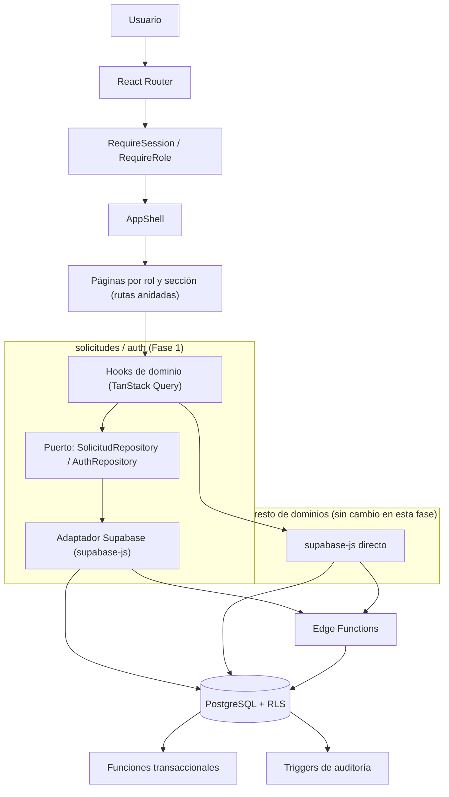

# Informe — Fase 1 de la propuesta de arquitectura escalable

**Fecha:** 22 de agosto de 2026
**Alcance:** ejecución de la Fase 0 (medición/contexto) y Fase 1 (fronteras y calidad) de la
propuesta de arquitectura escalable, sobre el Sistema de Solicitudes de Servicio.
**Ejecutado por:** múltiples agentes de Claude Code en serie/paralelo, orquestados en una sesión
única.

---

## 1. Resumen ejecutivo

Se recibió una propuesta de arquitectura escalable (`Propuesta_Arquitectura_Escalable_React_Supabase.md`,
adjuntada por el usuario) que recomienda evolucionar el sistema en 6 fases (0 a 5): medición y
decisiones, fronteras y calidad, integración segura, rendimiento y datos, observabilidad y
continuidad, y escalamiento basado en evidencia. Dado el tamaño de esa propuesta y el riesgo de
ejecutarla completa de una sola vez sobre una aplicación en producción sin herramienta de QA visual
disponible en este entorno, se acordó con el usuario ejecutar **solo la Fase 0 y la Fase 1
completas y verificadas**, dejando las Fases 2 a 5 documentadas como hoja de ruta priorizada (sección
6 de este informe), no implementadas todavía.

### Qué se hizo

| Fase | Elemento | Estado |
|---|---:|---|
| 0 | Checkpoint de seguridad: 11 días de trabajo sin comitear (145 archivos) respaldados en un commit | ✅ Hecho |
| 0 | Verificación de contexto real del repositorio (dos documentos de arquitectura ya existentes, confirmados vigentes) | ✅ Hecho |
| 1 | Infraestructura de pruebas automatizadas (Vitest + Testing Library + Playwright, integrada a CI) | ✅ Hecho |
| 1 | Puertos/adaptadores (patrón repository) para el dominio `solicitudes` | ✅ Hecho |
| 1 | Puertos/adaptadores (patrón repository) para el dominio `auth`, más `useLogin`/`useLogout` | ✅ Hecho |
| 1 | React Router: rutas reales por rol, enlaces profundos, sub-navegación por URL | ✅ Hecho |
| 2-5 | Outbox/workers, BFF, observabilidad, particionamiento, escalamiento basado en evidencia | 📋 Documentado como hoja de ruta, no ejecutado |

### Por qué se detuvo ahí

La propuesta original recomienda explícitamente medir antes de estructurar (Fase 0) y no avanzar a
integración/rendimiento/observabilidad sin fronteras y pruebas primero (Fase 1 antes que las demás).
Ir más allá de la Fase 1 en una sola pasada — outbox con workers reales, un vendor de observabilidad,
particionamiento sobre datos que hoy son de demostración — requiere decisiones de infraestructura y
negocio (qué proveedor, qué SLO, qué volumen real) que no son ejecutables por un agente de código sin
esa información, y que se documentan como preguntas abiertas en la sección 6.

### Verificación final (ejecutada íntegramente por el orquestador, no solo reportada por cada agente)

| Verificación | Resultado |
|---|---|
| `npx tsc -b` (TypeScript estricto) | ✅ Sin errores |
| `npm run lint` | ✅ 0 errores (1 warning preexistente sin relación, en `button.tsx`) |
| `npm run format:check` | ✅ Sin issues (se corrigió deuda de formato preexistente de 22 archivos ajenos a esta fase) |
| `npm run build` | ✅ Exitoso |
| `npm run test` (Vitest) | ✅ 3/3 suites, 10/10 pruebas |
| `npm run test:e2e` (Playwright, contra build de producción) | ✅ 2/2 pruebas |
| Verificación manual de rutas (`curl` sobre `/`, `/login`, `/bolsa-empleo`, `/administrador`, `/operador`, `/encargado`, `/cliente`, `/solicitante`, ruta inexistente) | ✅ Las 9 responden HTTP 200 |
| Revisión manual del código de Router/guards contra el comportamiento original | ✅ Verificado línea por línea, sin regresión de comportamiento |

**Limitación honesta:** este entorno no tiene herramienta de navegador/QA visual. La verificación de
Router se hizo por build+tipos+pruebas automatizadas+revisión manual de código+`curl`, no por
inspección visual en un navegador real. Se recomienda una prueba manual visual antes de desplegar a
producción.

---

## 2. Arquitectura nueva



Cambio central: React ya no decide la vista por `useState`+renderizado condicional (`HomePage`), sino
por una URL real resuelta con `react-router-dom`. Y dos dominios (`solicitudes`, `auth`) ya no llaman
a `supabase-js` desde los hooks — pasan por un puerto/adaptador, que es lo que permite sustituir el
adaptador por un doble de prueba en tests unitarios sin tocar componentes.

---

## 3. Árbol de rutas resultante

```text
/                     → redirige por rol (misma prioridad que antes: primer rol navegable
                         del perfil, en el orden que Supabase lo devuelve) o muestra el panel
                         "sin módulo asignado"
/login                → login (redirige a / si ya hay sesión)
/bolsa-empleo         → postulación pública de técnicos (sin guard)
/administrador        → guardada; 13 secciones anidadas (home, solicitudes, rutas,
                         notificaciones, reportes, clientes, tipos, materiales, vehiculos,
                         usuarios, proveedores, roles, marca)
/encargado            → guardada; 5 secciones anidadas (home, solicitudes, rutas,
                         notificaciones, reportes)
/solicitante          → guardada, sin subrutas
/operador             → guardada, sin subrutas
/cliente              → guardada; 4 secciones anidadas (solicitudes, validaciones,
                         tracking, documentos)
*                     → redirige a /
```

Todas las vistas internas ahora son enlazables/compartibles por URL — antes no lo eran (deuda
técnica ya documentada en `docs/arquitectura-actual.md`, ahora resuelta).

---

## 4. Archivos nuevos y modificados (resumen)

**Infraestructura de pruebas**: `src/test/setup.ts`, `playwright.config.ts`, `e2e/rutas-publicas.spec.ts`,
más specs junto a su código (`src/features/operador/lib/adjuntos.test.ts`,
`src/components/atoms/badge.test.tsx`, `src/components/molecules/connectivity-banner.test.tsx`);
modificados `vite.config.ts`, `package.json`, `.github/workflows/ci.yml`, `.gitignore`.

**Puertos/adaptadores `solicitudes`**: nuevos `src/features/solicitudes/{ports,adapters,lib}/*`;
modificados los 9 hooks existentes de `src/features/solicitudes/hooks/*.ts` y
`solicitudes.types.ts` (tipos consolidados).

**Puertos/adaptadores `auth`**: nuevos `src/features/auth/{ports,adapters,lib}/*`,
`hooks/use-login.ts`, `hooks/use-logout.ts`; modificados `use-session.ts`, `use-perfil-actual.ts`,
`auth.types.ts`, y los 4 componentes que llamaban al SDK de Auth directamente (`login-form.tsx`,
`account-menu.tsx`, `logout-button.tsx`, `session-panel.tsx`).

**Router**: nuevos `src/app/router.tsx`, `src/app/route-guards.tsx`, `src/app/role-shell.tsx`,
`src/app/roles-navegacion.ts`, `src/components/pages/inicio-page.tsx`,
`src/components/molecules/{cargando-sesion,aviso-supabase-no-configurado}.tsx`; eliminado
`src/components/pages/home-page.tsx`; modificados `app.tsx`, `app-shell.tsx`, `admin-shell.tsx`,
`admin-dashboard-page.tsx`, `encargado-dashboard-page.tsx`, `cliente-page.tsx`,
`bolsa-empleo-page.tsx`.

**Documentación**: este informe, más actualizaciones dirigidas en `docs/arquitectura-actual.md` y
`CLAUDE.md` (las secciones que hablaban de "no hay router"/"no hay pruebas" quedaron obsoletas y se
corrigieron).

---

## 5. Fases futuras — hoja de ruta priorizada (no ejecutadas)

Documentadas para continuidad, en el mismo orden recomendado por la propuesta original. Ninguna de
estas requiere revertir nada de la Fase 1 — se construyen encima.

| Fase | Qué falta | Por qué no se hizo ahora |
|---|---|---|
| 1 (continuación) | Extender puertos/adaptadores a los demás dominios (`flota`, `catalogos`, `cliente`, `tecnicos`, `notificaciones`, `usuarios`, `reportes`, `configuracion`) | Se estableció el patrón de referencia en 2 dominios; replicarlo al resto es trabajo mecánico pero extenso — mejor como iteraciones separadas y revisables, no en una sola pasada |
| 1 (continuación) | Unificar formularios controlados manualmente hacia React Hook Form + Zod | Cambio amplio de UI sin QA visual disponible; alto riesgo si se hace junto con Router |
| 1 (continuación) | Ampliar cobertura de pruebas (unitarias/componentes/E2E autenticados) más allá de los specs iniciales | Requiere credenciales de prueba de Supabase reales para E2E autenticado, que no están disponibles en este entorno |
| 2 | Matriz API/RPC obligatoria para comandos críticos, estandarizar errores/correlación/idempotencia | Depende de decidir primero el resto de dominios con puertos/adaptadores |
| 2 | Patrón outbox + worker para notificaciones/integraciones | Requiere infraestructura de colas/cron que Supabase no da lista por defecto (pg_cron + tabla outbox + Edge Function programada es viable, pero es una pieza de infraestructura nueva que merece su propia revisión) |
| 3 | Paginación por cursor, revisión de índices con planes de ejecución reales, caché selectiva, retención/archivado | Requiere datos y patrones de uso reales — hoy la base tiene datos de demostración, no producción |
| 4 | Observabilidad (logs estructurados, métricas, trazas correlacionadas), simulacros de restauración | Requiere elegir y contratar un proveedor de observabilidad — decisión de negocio, no de código |
| 5 | Réplicas, particiones, almacén analítico, evaluación de extracción de servicios | Explícitamente "basado en evidencia" en la propuesta original — no hay evidencia de producción todavía |

### Preguntas abiertas que el negocio debe responder antes de continuar

Las mismas que ya planteaba la propuesta original (sección 2.3), sin respuesta disponible para un
agente de código: volumen esperado de usuarios/solicitudes a 1-3-5 años, retención esperada de
fotografías/documentos, requisitos de residencia de datos o conservación legal, RPO/RTO exigido, si
el sistema será multiempresa, y qué reportes requieren datos en tiempo real vs. consolidados.

---

## 6. Informe detallado

### 6.1 Fase 0 — Medición y contexto

Al iniciar se detectó que el repositorio tenía **143 archivos modificados/nuevos sin comitear desde
el 11 de agosto de 2026** (11 días de trabajo real: gestión de flota, técnicos/proveedores, bolsa de
empleo, tracking, comunicaciones, notificaciones internas, documentos de cliente, más el trabajo de
esta misma sesión). Antes de tocar nada más, se creó un **commit de checkpoint** (`c009e10`,
mensaje detallado con el inventario completo) tras confirmar que ese estado ya compilaba y pasaba
lint limpio (`tsc -b`, `npm run lint`).

Se verificó también que los dos documentos de arquitectura ya existentes (`docs/arquitectura-actual.md`,
`docs/arquitectura-tecnica-estructural.md`) reflejaban con precisión el estado real del código —
sirvieron como base de contexto confiable, evitando repetir exploración ya hecha.

### 6.2 Infraestructura de pruebas (Vitest + Testing Library + Playwright)

**Motivación**: la propia propuesta señala "automatizar pruebas... antes de cambios estructurales
mayores" como la primera prioridad de la Fase 1 — se ejecutó primero por eso, y porque es aditiva
(no modifica comportamiento existente), lo que la hace segura para correr en paralelo con el
siguiente ítem.

**Qué se agregó**:
- Vitest configurado dentro del propio `vite.config.ts` (reutiliza el alias `@` y el plugin de React
  ya existentes, sin duplicar configuración), entorno `jsdom`, `globals: true`.
- 3 archivos de prueba representativos (no relleno): validación de adjuntos (`adjuntos.test.ts`),
  un componente con variantes (`badge.test.tsx`), y un componente que depende de estado de red
  mockeado (`connectivity-banner.test.tsx`) — 10 pruebas en total.
- Playwright configurado para correr contra el **build de producción real** (`npm run build && npm run preview`),
  no contra `npm run dev` — con 2 pruebas E2E que **no requieren credenciales de Supabase**
  (verifican que las rutas públicas `/` y `/bolsa-empleo` rendericen correctamente), para que
  funcionen en CI sin secretos.
- CI actualizado: `npm run test` después de lint/format, `npm run test:e2e` después del build.

**Incidente encontrado y resuelto durante la integración**: tras el siguiente paso (puertos/adaptadores
de `auth`), `npm run test` empezó a fallar con `TypeError: Cannot read properties of undefined (reading 'config')`
en las 3 suites. Se investigó directamente (no se aceptó la explicación del agente sin verificar) y
se confirmó que era una **caché de Vite corrupta** (`node_modules/.vite`, un artefacto local no
versionado), no un defecto de código — se limpió (`rm -rf node_modules/.vite`) y las 10 pruebas
volvieron a pasar. No requirió cambios de código.

### 6.3 Puertos/adaptadores — dominio `solicitudes`

**Motivación**: es el dominio central del sistema y el que la propuesta original recomienda
explícitamente como punto de partida ("empezando por `solicitudes` y `auth`"). Se verificó primero,
mediante un agente de exploración de solo lectura, que los 9 hooks del dominio (`use-solicitudes-admin`,
`use-editar-solicitud`, `use-materiales-solicitud`, `use-comunicaciones-solicitud`,
`use-tracking-solicitud`, `use-crear-solicitud`, `use-gestionar-solicitud`, `use-mis-solicitudes`,
`use-operadores`) ya estaban bien contenidos (ningún componente fuera de esos hooks accedía a las
tablas de solicitudes directamente) — lo que hizo el refactor mecánico y de bajo riesgo.

**Qué se hizo**: se introdujo `SolicitudRepository` (interfaz, `ports/`), `SupabaseSolicitudRepository`
(implementación, `adapters/`) y una instancia por defecto (`lib/repository.ts`). Los 9 hooks se
refactorizaron para llamar al repositorio en vez de a `supabase-js` directamente — **sin cambiar
ninguna firma pública, query key de TanStack Query, ni mensaje de error observable**. Se
aprovechó para consolidar 3 tipos que vivían duplicados/locales dentro de cada hook
(`MaterialSolicitud`, `Comunicacion`, `MiSolicitud`) hacia `solicitudes.types.ts`.

**Hallazgo documentado, no corregido en esta fase**: la acción `resolver_peticion` de
`use-gestionar-solicitud.ts` invoca la función RPC `resolver_peticion_solicitud` directamente desde
el cliente, en vez de pasar por la Edge Function `gestionar-solicitud` como el resto de acciones de
gestión — es una inconsistencia arquitectónica preexistente (no introducida en esta fase), señalada
para revisión futura.

**Verificación**: `tsc -b`, `lint`, `build` limpios; grep confirma cero llamadas a
`supabase.from/rpc/functions.invoke/storage/auth` dentro de `src/features/solicitudes/hooks/*.ts`.

### 6.4 Puertos/adaptadores — dominio `auth`

**Motivación**: a diferencia de `solicitudes`, este dominio sí tenía acoplamiento disperso: 4
componentes de UI (`login-form.tsx`, `account-menu.tsx`, `logout-button.tsx`, `session-panel.tsx`)
llamaban a `supabase.auth.signInWithPassword`/`signOut` directamente, sin pasar por ningún hook.

**Qué se hizo**: `AuthRepository` (`ports/`), `SupabaseAuthRepository` (`adapters/`), instancia por
defecto (`lib/repository.ts`) — mismo patrón que `solicitudes`, para consistencia. `use-session.ts`
y `use-perfil-actual.ts` se refactorizaron para usar el repositorio, **preservando exactamente su
forma de retorno pública** (crítico, porque el Router construido inmediatamente después depende de
esa forma). Se agregaron `useLogin()`/`useLogout()` (nuevos, con `useMutation`) que absorbieron las
4 llamadas directas al SDK.

**Verificación**: `tsc -b`, `lint`, `build` limpios; grep confirma que los 4 componentes ya no llaman
a `supabase.auth.` directamente; `npm run test` (una vez limpiada la caché del punto 6.2) sigue en
10/10.

### 6.5 React Router

**Motivación**: era la pieza de mayor riesgo — toca prácticamente cada página del sistema — por eso
se ejecutó **al final y en solitario** (no en paralelo con nada más), sobre la base ya estabilizada
de `auth`/`solicitudes`, y con instrucciones extremadamente detalladas y prescriptivas (mapa completo
de navegación actual, verificado por un agente de exploración dedicado antes de escribir una sola
línea de Router).

**Qué se hizo**: se instaló `react-router-dom` (`BrowserRouter`, no `createBrowserRouter` — no había
necesidad de loaders/actions que justificaran esa complejidad adicional). Se construyó el árbol de
rutas descrito en la sección 3, con dos guards (`RequireSession`, `RequireRole`) que replican
exactamente la lógica de control de acceso que antes vivía en `HomePage`. Se eliminó
`home-page.tsx`, reemplazado por `InicioPage` (ruta `/`) más los componentes de composición en
`src/app/`.

**Verificación propia, no solo la del agente**: dado el riesgo, se releyó personalmente el código
completo de `router.tsx`, `route-guards.tsx`, `inicio-page.tsx`, `roles-navegacion.ts` y
`role-shell.tsx`, y se comparó **línea por línea contra el `home-page.tsx` original** (recuperado del
commit de checkpoint vía `git show`) para confirmar que la lógica de prioridad de rol por defecto
(`perfil.data?.roles.filter(rol => whitelist.includes(rol))`, que preserva el orden en que Supabase
devuelve los roles del usuario, no un orden fijo de prioridad) se reimplementó de forma
**exactamente equivalente** — se detectó una posible discrepancia por un comentario ambiguo del
propio código nuevo, se investigó contra la fuente original, y se confirmó que **no había
regresión**.

Además de la revisión de código, se levantó el servidor de desarrollo y se verificó con `curl` que
las 9 rutas principales (`/`, `/login`, `/bolsa-empleo`, y las 5 ramas de rol, más una ruta
inexistente) responden HTTP 200 sin error de servidor.

**Limitación explícita**: sin herramienta de navegador en este entorno, no hubo verificación visual
real (clicks, formularios, estados de carga en pantalla). La cobertura de Playwright E2E hoy solo
alcanza las 2 rutas públicas sin sesión — **se recomienda una prueba manual en navegador real,
navegando cada rol, antes de considerar esto listo para producción.**

### 6.6 Verificación final integrada

Ejecutada de forma independiente por el orquestador (no delegada a los agentes individuales), después
de que las 4 piezas de la Fase 1 quedaron integradas en el mismo árbol de trabajo — para detectar
cualquier problema de integración entre los cambios de distintos agentes que ninguno por separado
podría ver. Resultados en la tabla de la sección 1. Se corrigió además deuda de formato preexistente
en 22 archivos no relacionados con esta fase (`npm run format` sobre todo el repo), dado que
`format:check` es parte del CI y debía quedar limpio.

---

## 7. Recomendación de cierre

El árbol de trabajo actual (Fase 0 + Fase 1 completas y verificadas) es un buen punto para un nuevo
commit — de nuevo como checkpoint de seguridad antes de continuar con cualquier fase futura. No se
creó ese commit automáticamente; se solicita confirmación explícita del usuario, siguiendo la misma
práctica ya establecida en esta sesión.
