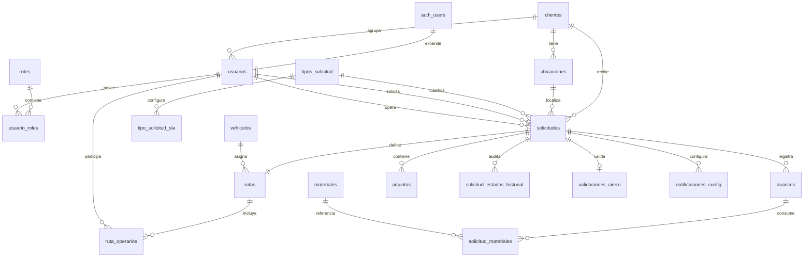

# Modelo de datos — Fase 1

## Decisiones principales

- `usuarios` extiende `auth.users`; su identificador es el mismo UUID de Supabase Auth.
- La autorización es multirrol mediante `roles` y `usuario_roles`.
- Un usuario cliente se vincula opcionalmente con un registro de `clientes`.
- La prioridad puede permanecer vacía mientras la solicitud esté en estado `creada`.
- Los SLA configurables viven en `tipo_solicitud_sla`, por tipo y prioridad.
- Cada solicitud tiene como máximo una ruta; la restricción se garantiza usando `solicitud_id` como clave primaria de `rutas`.
- Los cambios de estado se auditan en `solicitud_estados_historial`.
- La aceptación del cliente se registra en `validaciones_cierre` y es necesaria para cerrar.
- Las políticas RLS usan funciones `security definer` pequeñas para evitar recursión sobre `usuario_roles`.

## Relaciones

## Roles iniciales

- `administrador`
- `encargado`
- `operador`
- `cliente`
- `solicitante`

La creación del primer administrador se realiza después de registrar el usuario en Auth, asignándole el rol mediante SQL con credenciales de servicio. Ningún usuario puede autoasignarse roles.
